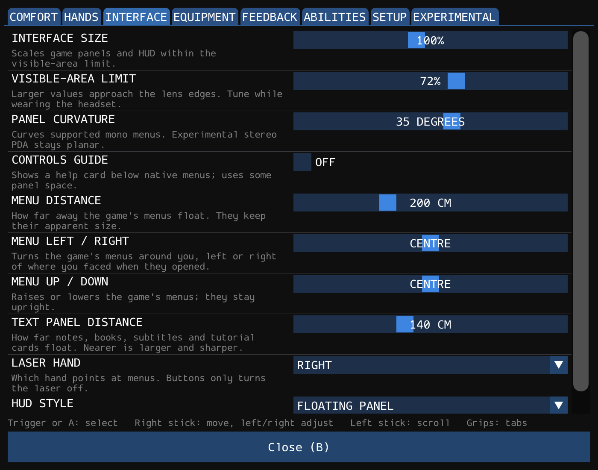

# VR Options panel (Dear ImGui) — 2026-10-13

The in-headset VR Options panel, rebuilt so it can grow. The classic card
([VR options](VR-OPTIONS-2026-09-27.md)) was hand-placed GDI with its layout
written twice (drawing and hit-testing), and its 8 × 4 grid was full. A Dear
ImGui panel was added beside it (step 2), given its own layout and every
setting (step 3), and is now the only panel: **step 4 retired the classic card
and the `NewVROptionsUI` switch** (2026-10-14, below).

The first version (headset-tested 2026-10-13) copied the classic card's look.
It now uses ImGui's own dark style and widgets. The restyled panel, menu
placement, the D-pad and A on a checkbox were worn on 2026-10-13; step 3, the
panel over the running game, and moving it were worn on 2026-10-14. Step 4 is
offline-tested only.

## Opening it

- Hold left Menu, F10, or `vr.options 1` -- in play or in a game menu alike
  (see "Over the running game" below). Until step 4, `NewVROptionsUI` in
  `PreyVR.json` and `vr.optionsui` chose between this panel and the classic
  card; both are gone.

## What it shows

- A tab per category -- Comfort, Hands, Interface, Equipment, Feedback,
  Abilities, Setup, then **EXPERIMENTAL** -- then that category's settings as a
  list: name and help on the left, the control on the right.
- **The control follows the setting:** a checkbox for on/off; a choice list for
  named choices (head/body relative, hold/toggle, body following, psychic
  targeting) and for turning (smooth, 15, 30, 45, 60, 90 degrees); a slider for
  ranges; a button for recenter, calibrate and clear holsters. A tab's rows come
  from `options::MenuEntries` (any number per tab), and each control from its
  setting's `options::Spec` (`options::KindOf`, `Choices`, `Display`).
- **Menu placement** on the Interface tab: menu distance
  (100–400 cm), left/right (−90–90°) and up/down (−45–45°) -- `ui.distance` and
  `ui.offset`. **Saved**, like every row (step 3; until then they were session
  only). They take effect when the game menu is next shown (closing VR Options
  shows it), and move VR Options itself at once.
- **Scrolling.** The list scrolls between the fixed tabs and the fixed back
  button whenever a category is longer than the panel: by the left stick, by the
  scrollbar (sized as a laser target), or by the right stick moving to a row out
  of sight. Comfort, Hands, Interface, Equipment and Experimental are longer
  than the panel at the designed text size.
- Controls: point and pull the trigger; right stick up/down moves; **A acts on
  the control under the laser, as the trigger does, else on the selected one**
  (the one the stick moved to or the laser last clicked) -- chosen as A goes
  down, kept until it comes up; **right stick left/right steps a slider or choice list** -- the one
  under the laser, else the one last selected -- once per press, then repeating
  while held (0.4 s, then every 0.1 s), and kept on that control until let go;
  left stick scrolls; grips step through the tabs; B or "Close"
  closes. A step is the setting's own (interface size 10%, curvature 5 degrees,
  ...), 5 cm for menu distance and 1 degree for the offsets; checkboxes are left
  to A and the trigger.
- **Placed from the game menus' anchor, but by its own placement** (see
  "Moving it" below). It is fitted from the same anchor as the game's menu
  panel (`ui::MenuAnchor`: the upright head and levelled eyes, taken when the
  game menu opened or the view was recentred), so it opens over the game menu
  it was opened from; over the running game it anchors afresh in front of the
  wearer. It opens 2 m straight ahead of that anchor, or where it was dragged
  to this session; `ui.distance` and `ui.offset` are the game menus' alone. Its
  size is its own (scale 1, margin 0.68, fitted at 2 m).
- **Changing the game menus' placement moves the game menu**, which now shows
  behind VR Options, from the anchor. Re-placing from where the wearer looks now
  would add an offset again each time (look 30 degrees right at a menu offset
  30 degrees, change its distance, and it would jump to 60). The anchor is
  replaced only when a game menu opens, on recenter, or when the tracking space
  changes.

## How it is built

- **Library.** Dear ImGui v1.92.9b, pinned by commit (`f1cc2ae1…`), fetched by
  CMake and built as `preyvr_imgui`: core plus the DX11 backend; no demo, no
  debug tools, no Win32 clipboard/IME or shell calls. It never sees the game's
  window: the mod feeds it input. No `imgui.ini` or log file is written. The
  commit is in the build manifest and its licence in the player package.
- **Look.** `StyleColorsDark` and ImGui's scalable default font at 30 px, with
  every size scaled to match (2.25 × the style's 13 px design). The window is
  opaque. `VrOptionsUi(textScale)` scales text and spacing together (the panel
  uses 1).
- **Drawing** (`src/dll/VrOptionsUi.*`). On the XR frame thread, on the game's
  device, into its own 1400 × 1100 target (`options::Width` × `Height`, which
  the laser's mapping onto it also uses). The target is typeless with a UNORM
  view, so the copy into the sRGB swapchain converts nothing. It is redrawn
  every frame it is open. `VrOptionsLayer` (`src/dll/VrOptionsLayer.*`) owns
  its swapchain, placement and drag, and hands the frame loop its layer.
- **The game's pipeline state** is saved and restored around the draw by
  `D3D11SavedState`, shared with the debug overlay and extended to the compute
  shader: ImGui's backend restores most state itself, but not the render
  targets, and clears hull/domain/compute shaders without restoring them.
- **Input.** The menu state machine (`options::Menu`) only opens, closes on B,
  owns input and waits for neutral controls. Its frame's controls go to ImGui:
  laser position and trigger as the mouse, navigation up/down
  (`TrackingFrame::navigate`: the right stick, and any controller's own
  navigation buttons) as the gamepad D-pad (0.6 engage / 0.35 release),
  A as activate, left stick (past 0.2) as scrolling, grips as tab steps. The
  stick's left/right is not given to ImGui (one control per row leaves sideways
  navigation nothing to reach); the panel steps the targeted control with it.
  Nothing is pressed until the controls have been neutral since opening.
- **Changes.** Checkboxes and choice lists send a value at once; a slider shows
  where it is dragged and sends once, when let go (otherwise a drag would save
  to disk every frame). They leave as `options::Change` -- a setting and its
  value, refused unless `options::Valid`, or a button -- and go through one
  handler: the save to `vr-options.ini`, the haptic pulse, the
  recenter/calibrate/clear actions.
  Menu placement is a setting like the rest (`ui_distance`, `ui_offset_right`,
  `ui_offset_up`).

## Step 3: every row, every setting saved (2026-10-13)

- **No cap on rows.** The settings table (`options::Spec`) is the one list of
  settings; each tab's rows are `options::MenuEntries(page)`. The runtime keeps
  one changed-flag per setting, so the old 32-setting mask is gone. (Until step
  4 the classic card kept its 8 × 4 grid and showed only its original rows.)
- **26 new rows** (ranges and defaults in [the tuning reference](TUNING-COMMANDS.md)):
  - Comfort: move and turn stick deadzones, sideways and backward speed, body
    turn deadzone (`arm.torso`, arms and body together), body step distance and
    body glide (`body.zone`; the stop stays below the start).
  - Hands: hands without a weapon (`arms.free`), carry grip (`carry.hold`),
    grenade throw (`grenade.hand`), object and grenade throw strength (the
    first value of `carry.throw` / `grenade.throw`).
  - Interface: text panel distance (`ui.text`), laser hand (`ui.pointer`), HUD
    style (`hud.layer`), beside menu placement (now saved).
  - Equipment: status on HUD too (`wrist.face`, inverted), wrist tick
    (`wrist.haptic`), wrist display position, height and tilt (`wrist.place`).
  - **Experimental**: physical carrying (`carry.hand`; switched on only while
    the left hand is the use hand), stick charges to surfaces
    (`grenade.deploy`), long-weapon hold-back (`ik.longreach`), inventory
    layer, stereo inventory and its depth (`ui.inventory`, `ui.stereo`,
    `ui.depth`).
  The tab bar's side padding is halved so all the names fit (nine tabs until
  step 4 folded Physical into Experimental).
- **Saved, and applied last.** `vr-options.ini` holds the settings chosen in
  the menu (and those already in the file) -- `options::Present` -- never the
  live lane values. It is read once, at the first VR start, and applied by
  `ApplySavedVrOptions` at **every** VR start, after VR start's own defaults: a
  saved choice wins, an unchosen setting keeps its built-in value. A command
  changes a setting for the session only.
- **One source.** `vr-options.ini` is the only place VR Options settings come
  from. `PreyVR.json` keeps launch settings only (render size, reference space,
  `DualStereo`; `NewVROptionsUI` until step 4). The launcher lost `-SnapTurnDegrees`,
  `-HeadRelativeMovement`, `-UiScalePercent`, `-UiCurveDegrees`, `-UiGuide`,
  `-PointerHand`, `-HudLayer`, `-DebugOverlay` and `-MuzzleAim`, sends no
  `move.snap`/`move.headrelative`/`ui.scale`/`ui.guide` before `vr.enable`, and
  sets none of `PREYVR_UI_CURVE_DEGREES`, `PREYVR_POINTER_HAND`,
  `PREYVR_HUD_LAYER`, which VR start no longer reads. An older `PreyVR.json`'s
  values move into `vr-options.ini` once (`Move-PreyVRMenuSettings`): only a
  changed value, only if the file lacks that setting, only if in the DLL's range;
  then they leave `PreyVR.json`. *Removed 2026-10-15*, with the `NewVROptionsUI`
  cleanup, once no saved `PreyVR.json` still carried them: an older file's
  values are now ignored. With no launcher switch left, a saved debug
  overlay or muzzle-aim "off" applies like any other choice.
- **Fixes found while cataloguing the commands:**
  - *Debug overlay "off" did not survive a restart*: VR start switched the rays
    on whenever the mask was 0. It no longer does.
  - *A tuner change was saved by the next menu save*: saving wrote the live
    values. It now writes only the saved record.
  - *Bare commands changed values*: 73 commands set a default or switched
    something on when typed with no value (`ui.curve` reset curvature,
    `ik.mode` switched the arms off). They now report (each command's own
    check since step 4).
  - *`ui.curve` from the launcher beat the saved curvature after F11*: the file
    was applied once, the launcher's value at every start. Saved choices are now
    applied at every start, and the launcher passes no curvature.
  - A slider value outside its setting's range is no longer recorded as a
    choice.
- **Tuning reference**: [`TUNING-COMMANDS.md`](TUNING-COMMANDS.md) lists every
  command, what the menu saves, and what wins over what.

## Over the running game (2026-10-14)

Until now VR Options opened only over a game menu (a long hold in play paused
the game first), and while it was open the frame submitted nothing but its own
panel: it floated in black, the game menu it was opened over gone too.

- **The same long hold opens it anywhere**, over what is shown, and **the game
  is not paused** (the wearer's choice). In play it opens over the live stereo
  world; in a game menu, over that menu. A short tap is still the game's pause.
  F10 and `vr.options 1` open it in play too. If a game menu opens under it,
  or the menu it was opened over closes, it closes (`options::Menu::OverMenu`).
- **Drawn over what is shown.** `ui::ComposeFrame` (`UiPanel.h`) orders a frame's
  layers: the world, or the game menu with its stereo half and guide card; then
  VR Options; then the laser and cursor. While it is open the HUD, text panel,
  wrist, slot and fade layers stay out (the last three paused by their own
  lanes), so nothing nearer than the panel is drawn behind it. Layers do not
  depth-test, so the panel reads as on top of the world even with a wall nearer.
- **It holds its place** on frames without a finished eye pair: placement is no
  longer dropped when a frame has no image (that frame submits nothing), which
  over the world would have re-anchored it wherever the wearer looked next.
- **Input** was already held for it: `HudGameplayInputAllowed()` is false while
  VR Options owns the controllers, which stops movement, turning, fire (and so
  grenade throws), use, psi, holsters and the two-hand hold, each waiting for
  neutral controls after it closes. One-hand aim keeps following the controller.
- **Worn 2026-10-14:** everything worked as expected; over a game menu it
  overlapped that menu exactly, which moving it (below) addressed. Not specifically reported:
  readability over a bright scene; what happens to an object being carried
  when it opens.

## Moving it (2026-10-14)

VR Options opened on the game menu's anchor at the game menu's distance and
offset, so over a game menu the two overlapped exactly. It now has its own
placement, and the laser drags it.

- **Grab: the trigger on nothing that answers.** A trigger press with the laser
  on the panel but on no control -- a setting's name or help, empty space -- grabs
  it (`VrOptionsUiResult::grabStarted`). Taken from ImGui's own hovered and active
  item that frame (`GetHoveredID`, `GetActiveID`, from `imgui_internal.h`; ImGui is
  pinned), so the scrollbar and the tabs count as controls; never while a choice
  list was open, since that press closes it; never by A. The hint line says
  "Hold the trigger here to drag the panel" while the laser is on such a spot.
- **Held** (`VrOptionsGrab`, VrOptionsRuntime): until the trigger is let go or the
  panel closes. Meanwhile the trigger reaches no control, the sticks navigate
  and scroll nothing, the laser hand's stick (past 0.2) pushes and pulls it, and
  the hint reads "Moving: ...". A light pulse marks the grab and the drop.
- **Round the inside of a cylinder** (`ui::DragPanel`, UiPanel): the laser is met
  with a vertical cylinder about the head, of the grabbed spot's distance across
  the floor; that spot stays where the laser meets it. Swung sideways it goes
  round you; raised or lowered it slides straight up or down at the same
  distance, never tilting toward the eyes (no higher or lower than 60 degrees
  from the head). It stays upright, turned to face the cylinder's axis. The
  stick changes the radius, 0.5 to 5 m at 1.5 m/s; the panel keeps its physical
  size, so nearer reads larger. A hand held out past the cylinder widens it
  rather than losing the panel; a laser straight up leaves it where it was.
- **Kept for the session**: let go (or closed while held), its place is stored
  relative to the anchor it opened from (`ui::PanelPlacement`: turned, raised,
  distance across the floor), and the next opening -- over the game or a game
  menu -- puts it there relative to that opening's anchor. A recenter re-places
  it the same way and drops a grab in progress. Not saved to disk; held by the XR
  session, so an F11 restart forgets it too.
- Game menus are not grabbable yet (deferred: the trigger is their click
  everywhere).
- **Worn 2026-10-14:** tested and verified by the wearer.

## Step 4: one panel, and a cleanup (2026-10-14)

From a review of the branch: Steam Frame handling mixed into the shared input
code, leftovers of the classic card, and logic kept in two places.

- **The classic card is gone**, with `NewVROptionsUI`, `PREYVR_NEW_VR_OPTIONS_UI`
  and `vr.optionsui`. The launcher drops a saved `NewVROptionsUI` from
  `PreyVR.json` and says so. Gone with it: the card's grid and hit-testing
  (`options::Item`, `Hit`, `Adjust`), the state machine's navigation (it only
  opens, closes and owns input now), `Change::direction` and `Change::set` (a
  change is a value), and `VrOptionsPanel.*`.
- **Each controller in its own module** (`preyvr/ControllerProfiles.h`,
  `src/common/ControllerProfiles.cpp`). Touch, Index and the Steam Frame each
  list their bindings by a device-neutral role (`input::Role`) over one shared
  set: poses, sticks, triggers, grips, haptics and the weapon wheel. A profile
  names the extension it needs; `XrInput` asks for each such extension, suggests
  the profiles whose extension was enabled, and tries each profile's binding
  sets in order. Only the Frame's module knows its D-pad: bound as Touch's X/Y
  for the game, as SteamVR's emulation placed them, and to four navigation
  roles. `XrInput` composes those with the right stick into
  `TrackingFrame::navigate`, the one navigation the panel reads; the per-hand
  D-pad fields are gone. Logged as `xr_input_extension name=... enabled=0|1`
  and `detail=bindings profile=... set=...`.
- **One description per setting.** `options::Spec` gives each setting how its
  value reads as well as its range -- a unit, named values, a fixed set of
  choices, what 0 reads as -- and `KindOf`, `Choices` and `Display` read that
  rather than naming settings; turning's six choices are written once. The
  runtime's `wiring` table gives each setting its setter and getter in one row,
  in setting order (checked at compile time), where `Apply` and
  `VrOptionsValues` each had a switch.
- **Experimental features on the Experimental tab.** Physical wrench, object
  nudges and their speed and strength (the Physical tab), Scene reticle (from
  Feedback) and Shots from the muzzle (from Setup) join it, so there are eight
  tabs; labels no longer say "(EXPERIMENTAL)". The holster help says
  assignments are not saved.
- **No value, no change, in each command.** The bare-command rule moved from a
  separate list of verbs into each handler: a setter runs only when given a
  value (`Valued`), and a bare verb shows the value where its lane has one, else
  `note=no_value_nothing_changed`. `ik.mode`, `move.mode` and `hand.mode` now
  report the mode in effect rather than the one asked for. An audit of
  `CommandChannel.cpp` found no setter left that runs without a value.
- **One placement model.** `ui::AroundHead` (the game menus' `ui.offset`) goes
  through `ui::PanelPlacement`, as the dragged panel does.
- **The frame loop's VR Options code** moved into `VrOptionsLayer`. The wrist,
  slot and fade layers are gated once, by their own lanes, not again in
  `ui::ComposeFrame`.
- **Smaller fixes:** "no target" in the panel is `kNoKey` rather than -2, which
  is now Clear holster slots' id; the state machine's B latch, which could
  never be set when read, is gone; the `ui.distance`/`ui.offset` comments said
  an open menu is placed afresh in front of the wearer (it is refitted where it
  opened).
- **Validation:** CTest 70/70 (`controller_profiles` added; `vr_options_panel`
  and `launcher_options_ui` went with the card). Breaking any of 14 rules makes
  a test fail (checked): B closing; turning refusing 1..14; turning being a
  choice; millimetres read as metres; a setting on no tab; an invalid value
  refused; the navigation's hysteresis; navigation read from `navigate`; the
  wrist layer left to its caller; the Frame D-pad's right; Touch's Menu on the
  left; the weapon wheel in every set; the launcher keeping a retired key in
  DryRun, or retiring none.
- **Not yet worn.** Worth a look: the Frame's D-pad and the stick in the panel,
  the Experimental tab's longer list, and a bare `ui.curve` in **Tune Prey
  VR.cmd** reporting without resetting.

## Validation

- CTest 71/71 at step 3; 70/70 after step 4 (above). `vr_options_ui` draws the real panel with the real backend on WARP
  and checks the target (size, typeless family for both BGRA and RGBA
  presentations, the same picture with R and B swapped), an opaque ImGui
  background, a byte-for-byte copy into an sRGB image, that the caller's render
  target and viewport survive, and each control by laser: turning is a choice
  list and picking 30 degrees sends 30; two-hand aim is a checkbox and
  unticking sends off; a slider held and dragged shows the drag, sends nothing,
  and sends one change when let go; menu distance's far end sends about 400 cm
  and left/right's near end about 90 degrees left, as one change each; the
  interface page scrolls at the designed size; with larger text its last row
  starts under the footer, the left stick scrolls to the end, the row comes into
  view, a row reached by scrolling works, and it scrolls back; every row of
  every tab is drawn as a control; grips step through the Experimental tab and
  wrap; recenter sends its action; back closes. Left/right: right on the distance bar under the laser sends 5 cm
  further, nothing more until the repeat delay, then a step at a time; left 5 cm
  nearer; a laser moved to another slider mid-hold leaves the steps on the
  first, and a new press takes the new one (curvature, 5 degrees); with no laser
  on a control, the clicked interface-size slider steps by its 10%; the laser
  outranks the selection; nothing past 400 cm; turning steps 45 to 60 and not
  below smooth; a checkbox ignores it. Removing the state guard, the scrolling,
  the slider's send-on-release, or the held stick's lock each makes it fail
  (checked).
- `ui_panel` covers the shared anchor: a menu placed from it is fitted straight
  ahead of the upright head and carried around the cylinder; re-placed from the
  anchor it stays put, where anchoring afresh at the wearer's new gaze would
  move it by the offset again; a new distance keeps its direction.
- `vr_options` covers the state machine; `vr_options_runtime`
  covers the runtime path (input reaches the panel only when armed; a value
  applies and is saved; an out-of-range value
  changes nothing and is not saved; a command's change is not saved by the next
  menu save; each new setting and menu placement reaches its lane, reads back and is
  saved; physical carrying waits for the left hand's use; after a restart the
  file applies nothing until VR start, then the saved choices win over VR
  start's values and earlier commands while unchosen settings keep theirs; a
  saved debug overlay "off" stays off, over an earlier `dbg.draw`; an F11
  re-enable restores the saved curvature); `vr_options` covers every setting on
  exactly one tab, the actions once each, the specs, and the save file holding
  only chosen settings; `launcher_settings` covers the launcher owning no VR
  Options setting and the one-time move (keys, defaults and ranges checked
  against `VrOptions.cpp`; a menu choice kept; DryRun; idempotence). Saving live values,
  applying at load, recording a refused value, dropping a row from its tab or
  ignoring presence on save each makes a test fail (checked), as do putting the
  overlay exception back, sending a menu setting at startup, and the move
  overwriting a menu choice, moving a default or an out-of-range value, or
  writing in DryRun.
- `PREYVR_UI_PREVIEW=<dir>` makes `vr_options_ui` write every page as a PPM, the
  interface page scrolled to its end, and the turning list open.

## Open

- **Steam Frame D-pad** (headset report 2026-10-13: left/right did nothing).
  The mod offered only Touch and Index bindings, so SteamVR emulated one of them
  for the Frame controllers -- Touch, its higher-priority layout (95 against 90).
  Its Frame-to-Touch remapping (`frame_controller_remapping.json`) folds the left
  D-pad into X/Y: down as X; left, right and up all as Y (the Index layout does
  the same with A/B). The log's `input_created profile=oculus/touch_controller`
  was a fixed string, not the runtime's choice: it now lists the profiles
  offered, and `interaction_profile left=... right=...` records the one picked,
  from the runtime's profile-changed event. The mod
  now enables `XR_VALVE_frame_controller_interaction` when offered and suggests
  `/interaction_profiles/valve/frame_controller`, keeping every existing
  action's emulated binding and adding the D-pad (left/right adjust, up/down
  move). Each attempt is a complete binding set, the uncertain
  Menu button tried in order (View + Menu, Menu, View, left Menu), so a refusal
  stores nothing and Touch emulation carries on. Which attempt was accepted is
  logged (`detail=bindings profile=frame set=menu=...` since step 4); not yet
  read from a headset log.
- **A on a checkbox did nothing** (headset report 2026-10-13, Frame profile
  active: `interaction_profile left=/interaction_profiles/valve/frame_controller`).
  Not the controller: A was ImGui's gamepad activate, which reaches only the
  control the stick selected, never the one under the laser. Two fixes: A on a
  control under the laser is now a click there (the trigger's route; whether a
  control is under the laser is taken from this frame's controls, not ImGui's
  "any item hovered", which also counts the last frame); off a control, A shows
  ImGui's selection cursor so its activate can reach a control the laser
  selected. And a checkbox's label carried its ON/OFF in its ID (`"ON##value"`),
  so ticking it made a new control and the selection lost it; it is `###` now.
  Reverting either makes `vr_options_ui` fail (checked).
- Headset-confirmed 2026-10-13: the Frame D-pad and the right stick step the
  targeted control.
- Not specifically reported from a headset: the left/right repeat rate. Not
  yet measured: the per-frame draw's cost.
- Step 3 was worn 2026-10-14. Step 4 (above) is offline-tested only.
- Moving it (worn 2026-10-14) is covered offline: `ui_panel` covers the drag (held still it stays;
  swung, raised and pushed it keeps the grabbed spot under the laser on the
  cylinder, upright and facing the head, at its physical size; the 60 degree
  limit; a hand past the cylinder; the placement round trip, and from a turned
  anchor); `vr_options_ui` covers what grabs (a name and help do; a control, a
  tab, the scrollbar, a press with a list open and A do not); `vr_options_runtime`
  covers the hold (no click or navigation, the stick's push and pull, let go and
  close drop it, each grab its own). Breaking each of ten of these rules makes a
  test fail (checked).
- The bare-command rule is not covered by a test: `CommandChannel.cpp` has no
  unit harness. The DLL builds with it, and the step 4 audit is by reading.
